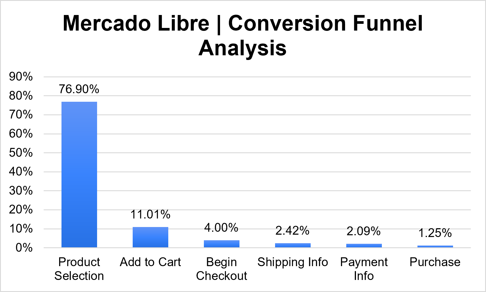
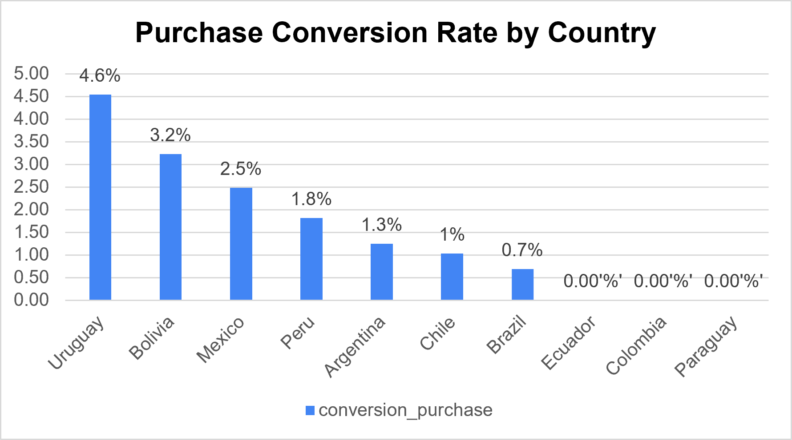
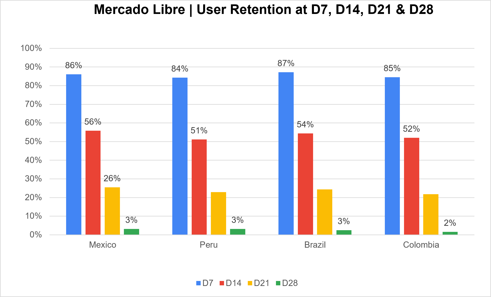
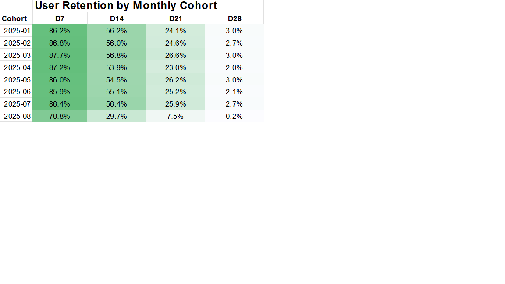

# Mercado Libre | Conversion Funnel & Retention Analysis

**Academic Case Study | TripleTen Data Analytics Program**

**Tools:** SQL | PostgreSQL | Conversion Funnel Analysis | Cohort Analysis | Data Visualization

## Project Overview

This project analyzes user behavior across the purchasing journey using a simulated Mercado Libre dataset.

The objective is to identify conversion bottlenecks, compare purchasing behavior across countries, evaluate user retention, and develop actionable business recommendations.

**Analysis Period:** January 1 – August 31, 2025.

## Business Questions

- Where are the largest declines in user participation across the purchasing funnel?
- How do purchase conversion rates differ across countries?
- How does user retention vary across D7, D14, D21, and D28?
- What differences can be observed across monthly registration cohorts?
- Which business initiatives could improve conversion and engagement?

## Methodology

The analysis was performed using SQL and included:

1. **Conversion Funnel Analysis:** Calculated stage-level participation rates relative to initial visitors.
2. **Country-Level Conversion Analysis:** Compared purchase conversion rates across markets.
3. **User Retention Analysis:** Evaluated recorded activity on or after D7, D14, D21, and D28.
4. **Monthly Cohort Analysis:** Grouped users by registration month to compare retention patterns.
5. **Business Recommendations:** Translated analytical findings into potential improvement initiatives.

## Key Findings

### 1. Conversion Funnel

- Product selection: **76.90%**
- Add to cart: **11.01%**
- Purchase: **1.25%**

The largest relative decline in stage participation occurred between product selection and add to cart, representing approximately **85.68%**.

### 2. Purchase Conversion by Country

Uruguay recorded the highest purchase conversion rate (**4.6%**), followed by Bolivia (**3.2%**) and Mexico (**2.5%**).

### 3. User Retention

Retention declined across the measured milestones. Brazil recorded the highest D7 rate (**87.2%**) among the countries highlighted, while Peru recorded the highest D28 rate (**3.2%**).

### 4. Monthly Cohort Retention

Retention patterns were relatively stable across January–July 2025 cohorts. The August cohort showed lower observed retention, potentially influenced by incomplete observation periods.

## Business Recommendations

- Investigate barriers between product selection and adding items to the cart.
- Evaluate pricing transparency, shipping cost visibility, and usability through research and A/B testing.
- Strengthen early-stage user engagement through personalized communications.
- Explore localized retention strategies for different markets.
- Monitor conversion and retention metrics through recurring reporting.

## SQL Skills Demonstrated

- Common Table Expressions (CTEs)
- LEFT JOIN
- COUNT and DISTINCT
- CASE WHEN and conditional aggregation
- GROUP BY and ORDER BY
- DATE_TRUNC, MIN, and TO_CHAR
- NULLIF and ROUND
- Percentage calculations

## Methodological Considerations

Funnel metrics represent event participation relative to initial visitors and do not enforce chronological progression through every stage.

Retention metrics represent recorded activity on or after each milestone rather than exact-day activity. The analysis period ends August 31, 2025, which may limit observation time for more recent cohorts.

## Full Project Documentation

View the complete case study, visualizations, SQL explanations, and business recommendations on Notion:

[Mercado Libre | Conversion Funnel & Retention Analysis — Notion](https://closed-eagle-55c.notion.site/Mercado-Libre-Conversion-Funnel-Retention-Analysis-41b8df29454280d4a46ac78bf0543584)

## Project Context

This is an academic case study developed as part of the TripleTen Data Analytics Program using simulated data. It does not represent an analysis commissioned by Mercado Libre.

## Project Visualizations

The following charts summarize the main findings of the analysis.

### 1. Overall Conversion Funnel

### 2. Purchase Conversion by Country

### 3. User Retention by Country

### 4. Monthly Cohort Retention

## SQL Analysis Files

Explore the SQL queries used in this project:

1. [Overall Conversion Funnel](sql/01_overall_conversion_funnel.sql)
2. [Conversion Funnel by Country](sql/02_conversion_by_country.sql)
3. [User Retention by Country](sql/03_retention_by_country.sql)
4. [Monthly Cohort Retention](sql/04_monthly_cohort_retention.sql)
